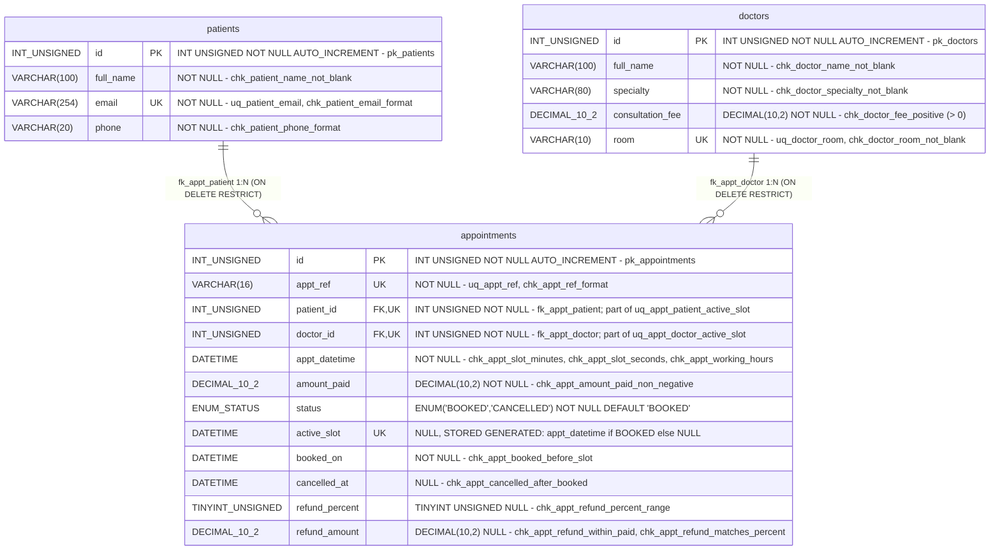

# MediBook Schema Diagram (Mermaid backup)

Equivalent to [`schema.dbml`](schema.dbml) and [`../database/schema.sql`](../database/schema.sql):
same 3 tables, columns, types and constraint names. GitHub and VS Code
(with a Mermaid extension) render this directly. To export an image, paste the
code block into <https://mermaid.live> and use **Actions → PNG**.

> Mermaid type names can't contain spaces or commas, so the diagram writes
> `INT_UNSIGNED` for `INT UNSIGNED`, `TINYINT_UNSIGNED` for `TINYINT UNSIGNED`,
> `DECIMAL_10_2` for `DECIMAL(10,2)` and `ENUM_STATUS` for `ENUM('BOOKED','CANCELLED')`.
> The exact MySQL type is repeated at the start of every comment.



## The slot rule: a doctor can't have two active appointments at the same date/time

```
active_slot DATETIME GENERATED ALWAYS AS
  (CASE WHEN status = 'BOOKED' THEN appt_datetime ELSE NULL END) STORED

UNIQUE uq_appt_doctor_active_slot  (doctor_id,  active_slot)
UNIQUE uq_appt_patient_active_slot (patient_id, active_slot)
```

| Row status | `active_slot` | Effect on the UNIQUE index |
|---|---|---|
| `BOOKED` | = `appt_datetime` | A second BOOKED row for the same doctor + time is **rejected** (ERROR 1062) |
| `CANCELLED` | `NULL` | NULLs never collide, so the cancelled record is **kept** and the slot can be **booked again** |

## Every constraint

| Table | Constraint | Type | Rule |
|---|---|---|---|
| patients | `pk_patients` | PRIMARY KEY | `id` |
| patients | `uq_patient_email` | UNIQUE | `email` (case-insensitive collation) |
| patients | `chk_patient_name_not_blank` | CHECK | `CHAR_LENGTH(TRIM(full_name)) > 0` |
| patients | `chk_patient_email_format` | CHECK | `email LIKE '%_@_%._%'` |
| patients | `chk_patient_phone_format` | CHECK | `REGEXP_LIKE(phone, '^[+]?[0-9][0-9 ()-]{5,18}[0-9]$')` |
| doctors | `pk_doctors` | PRIMARY KEY | `id` |
| doctors | `uq_doctor_room` | UNIQUE | `room` |
| doctors | `chk_doctor_name_not_blank` | CHECK | `CHAR_LENGTH(TRIM(full_name)) > 0` |
| doctors | `chk_doctor_specialty_not_blank` | CHECK | `CHAR_LENGTH(TRIM(specialty)) > 0` |
| doctors | `chk_doctor_room_not_blank` | CHECK | `CHAR_LENGTH(TRIM(room)) > 0` |
| doctors | `chk_doctor_fee_positive` | CHECK | `consultation_fee > 0` |
| appointments | `pk_appointments` | PRIMARY KEY | `id` |
| appointments | `uq_appt_ref` | UNIQUE | `appt_ref` |
| appointments | `uq_appt_doctor_active_slot` | UNIQUE | `(doctor_id, active_slot)` |
| appointments | `uq_appt_patient_active_slot` | UNIQUE | `(patient_id, active_slot)` |
| appointments | `fk_appt_patient` | FOREIGN KEY | `patient_id → patients.id` ON DELETE/UPDATE RESTRICT |
| appointments | `fk_appt_doctor` | FOREIGN KEY | `doctor_id → doctors.id` ON DELETE/UPDATE RESTRICT |
| appointments | `chk_appt_slot_minutes` | CHECK | `MINUTE(appt_datetime) IN (0, 30)` |
| appointments | `chk_appt_slot_seconds` | CHECK | `SECOND(appt_datetime) = 0` |
| appointments | `chk_appt_working_hours` | CHECK | `TIME(appt_datetime) BETWEEN '09:00:00' AND '16:30:00'` |
| appointments | `chk_appt_ref_format` | CHECK | `REGEXP_LIKE(appt_ref, '^AP-[0-9]{8}-[0-9A-Z]{4}$', 'c')` |
| appointments | `chk_appt_amount_paid_non_negative` | CHECK | `amount_paid >= 0` |
| appointments | `chk_appt_refund_percent_range` | CHECK | `refund_percent BETWEEN 0 AND 100` |
| appointments | `chk_appt_refund_within_paid` | CHECK | `refund_amount BETWEEN 0 AND amount_paid` |
| appointments | `chk_appt_refund_matches_percent` | CHECK | `refund_amount = ROUND(amount_paid * refund_percent / 100, 2)` |
| appointments | `chk_appt_status_consistency` | CHECK | BOOKED: `cancelled_at`, `refund_percent`, `refund_amount` all NULL; CANCELLED: all NOT NULL |
| appointments | `chk_appt_booked_before_slot` | CHECK | `booked_on < appt_datetime` |
| appointments | `chk_appt_cancelled_after_booked` | CHECK | `cancelled_at >= booked_on` |
| appointments | `idx_appt_doctor_datetime` | INDEX | `(doctor_id, appt_datetime)` (performance, not a rule) |

NOT NULL: every column except `appointments.active_slot`, `cancelled_at`,
`refund_percent` and `refund_amount`.

Cardinality: one patient has zero or many appointments; one doctor has zero or many
appointments; every appointment has exactly one patient and exactly one doctor.
